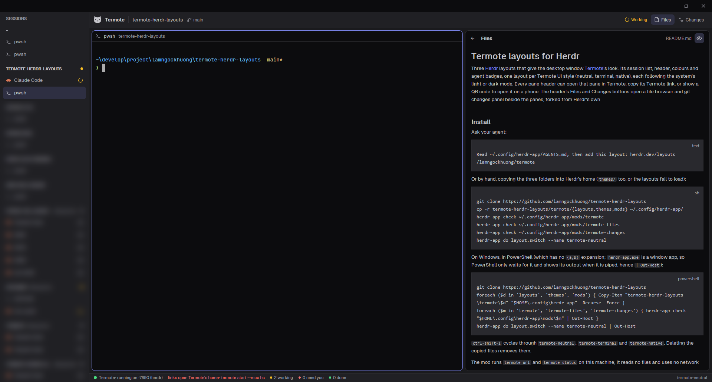

# Termote layouts for Herdr

Three [Herdr](https://herdr.dev) layouts that give the desktop window
[Termote](https://github.com/lamngockhuong/termote)'s look: its session list, header, colours and
agent badges, one layout per Termote UI style (neutral, terminal, native), each following the
system's light or dark mode. Every pane header can open that pane in Termote, copy its Termote
link, or show a QR code to open it on a phone. The header's Files and Changes buttons open a
file browser and git changes panel beside the panes, forked from Herdr's own.



## Install

Ask your agent:

```text
Read ~/.config/herdr-app/AGENTS.md, then add this layout: herdr.dev/layouts/lamngockhuong/termote
```

Or by hand, copying the three folders into Herdr's home (`themes/` too, or the layouts fail to
load):

```sh
git clone https://github.com/lamngockhuong/termote-herdr-layouts
cp -r termote-herdr-layouts/termote/{layouts,themes,mods} ~/.config/herdr-app/
herdr-app check ~/.config/herdr-app/mods/termote
herdr-app check ~/.config/herdr-app/mods/termote-files
herdr-app check ~/.config/herdr-app/mods/termote-changes
herdr-app do layout.switch --name termote-neutral
```

On Windows, in PowerShell (which has no `{a,b}` expansion; `herdr-app.exe` is a window app, so
PowerShell only waits for it and shows its output when it is piped, hence `| Out-Host`):

```powershell
git clone https://github.com/lamngockhuong/termote-herdr-layouts
foreach ($d in 'layouts', 'themes', 'mods') { Copy-Item "termote-herdr-layouts\termote\$d" "$HOME\.config\herdr-app" -Recurse -Force }
foreach ($m in 'termote', 'termote-files', 'termote-changes') { herdr-app check "$HOME\.config\herdr-app\mods\$m" | Out-Host }
herdr-app do layout.switch --name termote-neutral | Out-Host
```

`ctrl-shift-l` cycles through `termote-neutral`, `termote-terminal` and `termote-native`.
Deleting the copied files removes them.

The mod runs `termote url` and `termote status` on this machine; it reads no files and uses no
network itself. The Files and Changes panels list the focused pane's folder and run `git`
there, as Herdr's own panels do.

## Update

Ask your agent, saying to replace the copy you have (Herdr's `AGENTS.md` tells agents never to
overwrite, so without it they add a renamed second copy):

```text
Read ~/.config/herdr-app/AGENTS.md, then update this layout in place: herdr.dev/layouts/lamngockhuong/termote
Replace my installed termote-* layouts, themes and mods with the new files; don't rename them.
```

Or by hand, copying the new files over the old ones:

```sh
git -C termote-herdr-layouts pull
cp -r termote-herdr-layouts/termote/{layouts,themes,mods} ~/.config/herdr-app/
herdr-app check ~/.config/herdr-app/mods/termote
herdr-app check ~/.config/herdr-app/mods/termote-files
herdr-app check ~/.config/herdr-app/mods/termote-changes
```

On Windows, in PowerShell:

```powershell
git -C termote-herdr-layouts pull
foreach ($d in 'layouts', 'themes', 'mods') { Copy-Item "termote-herdr-layouts\termote\$d" "$HOME\.config\herdr-app" -Recurse -Force }
foreach ($m in 'termote', 'termote-files', 'termote-changes') { herdr-app check "$HOME\.config\herdr-app\mods\$m" | Out-Host }
```

Herdr reloads them within a second. Panel sizes and other clicks are kept (they live in
`layouts/.state/`). A file removed from the repo stays in your copy until you delete it.

## Requirements

- Herdr app 0.1.12 or later.
- For the pane buttons and the status strip: Termote 2.19 or later, started with
  `termote start --mux hc` (the buttons name panes by Herdr's ids). Without Termote the layouts
  still work; the buttons answer with a toast.

## What's inside

```
termote/
├── RECIPE.md                 the brief to build it from scratch
├── layouts/termote-*.json    one per style, with a settings preview (.svg)
├── themes/termote-*.json     light and dark per style
├── mods/termote/             the header, session list, pane header, status strip and QR popup
└── mods/termote-{files,changes}/  the Files and Changes panels, forked from Herdr's
```

Colours come from Termote's `pwa/src/index.css` and `pwa/src/components/terminal-view.tsx`.

## License

[MIT](LICENSE). `mods/termote-files` and `mods/termote-changes` are forked from
[Herdr](https://herdr.dev)'s `files` and `changes` mods and stay under the
[Apache License 2.0](LICENSE-APACHE).
