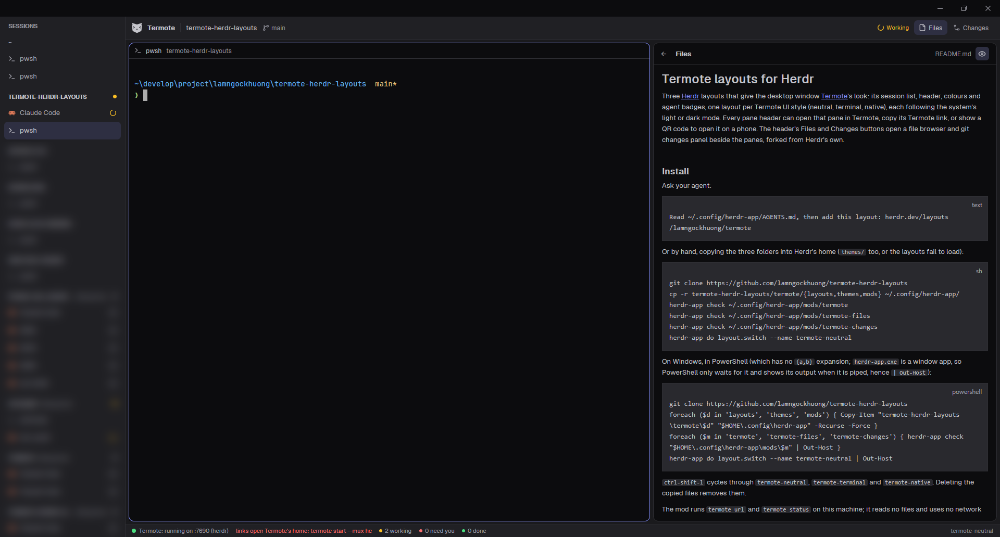

# Termote

Herdr dressed as [Termote](https://github.com/lamngockhuong/termote): its session list on the
left, its header over the panes, its colours and agent badges, in each of Termote's three UI
styles (neutral, terminal, native) and following the system's light or dark mode. Every pane
header can open that pane in Termote, copy its Termote link, or show a QR code to open it on a
phone.

The mod runs `termote` (`url`, `status`) on this machine; it reads no files and uses no network
itself.

This file is the brief: enough to build the three layouts from an empty folder. The files next
to it are one build of it.

## What you see

Three layouts, one per Termote style: `termote-neutral`, `termote-terminal`, `termote-native`.
They share one tree; left to right:

1. **The session list**, 240px wide (40–480, resizable), on `chrome`. A "SESSIONS" title
   (11px, semibold, `dim`), then one group per space: its name in capitals (11px semibold,
   `foreground` when shown, else `muted`), `@machine` for a space on another machine and the
   space's status dot (7px). Under it, its tabs as 34px rows (13px): program icon, name, a
   "zoomed" mark and the tab's status icon (14px). The shown tab's row is `selected` with
   medium text; in the terminal style it is `raised` with a 2px `accent` bar on its left, as
   in Termote. Other rows are `muted` and `hover` (`raised`) under the pointer.
2. **The header**, 44px, over the panes: the Termote owl (20px, `foreground`), "Termote"
   (13px semibold), a 1px divider, the shown space's name, its machine, its branch with a
   branch icon (12px, `dim`), and on the right the space's status badge. On `surface`; on
   `canvas` in the terminal style. 1px `border` below.
3. **The panes**, the shown tab as cards on `canvas`: gap and padding 6/4/8px, radius
   10/6/16px (Termote's `--tm-radius-panel`) for neutral/terminal/native, terminal background,
   1px `border`, `accent` when focused, a single pane framed too. Terminal padding `[10, 8]`.
4. **Each pane's header**, 30px on the terminal background, 1px `border` below, 12px: program
   icon, program or title (medium), the folder's last part (`dim`; split on `/` and `\`), the
   agent's badge.
5. **The status strip**, 24px on `chrome`, 1px `border` above, 11px `muted`: a dot and
   "Termote: running on :7680 (hc)" / "Termote: stopped" / "Termote: not installed"; counts of
   working, "need you" and done agents with their dots; the layout's name on the right.

Fonts: Geist for the interface. The terminal style sets names, titles and the status strip in
Geist Mono (Termote's `--tm-font-label`).

Badges are Termote's (`agent-status-badge.tsx`): an icon per status in its colour, and in the
header and pane headers its word in 11px.

| Status | Icon | Word | Colour |
|---|---|---|---|
| working | loader circle, turning once a second | Working | `working` = `--tm-warning` |
| blocked | circle with ! | Needs you | `blocked` = `--tm-danger` |
| done | circle with ✓ | Done | `done` = `--tm-success` |
| idle | circle with a dot | Idle | `idle` = `--tm-fg-subtle` |

Colours, from Termote v2.19.2 `pwa/src/index.css` and the terminal palette of
`pwa/src/components/terminal-view.tsx`:

| Theme | canvas | chrome | raised | selected | border | done | terminal |
|---|---|---|---|---|---|---|---|
| neutral light | #f7f7f8 | #f0f0f2 | #ffffff | #e3e2f1 | #e1e1e5 | #15773a | #f7f7f8 |
| neutral dark | #1a1a1d | #202024 | #29292e | #2e2f42 | #2f2f34 | #4ade80 | #0c0c0e |
| terminal light | #f7f8f6 | #eef1ed | #ffffff | #ffffff | #d9ded8 | #0d7a41 | #f7f8f6 |
| terminal dark | #0f1110 | #161917 | #1d2120 | #1d2120 | #272d2a | #3ddc84 | #0f1110 |
| native light | #f2f2f7 | #ffffff | #ffffff | #e0efff | #d8d8dd | #1f7a36 | #fafafa |
| native dark | #121214 | #1c1c1e | #2c2c2e | #26364a | #38383a | #30d158 | #0b0b0c |

| Theme | foreground | muted | dim | accent | working | blocked |
|---|---|---|---|---|---|---|
| neutral light | #27272a | #52525b | #63636b | #4f46e5 | #975c06 | #c81e1e |
| neutral dark | #c5c5cb | #a4a4ae | #93939c | #818cf8 | #fbbf24 | #f87171 |
| terminal light | #262b28 | #4b5650 | #5f6a64 | #0d7a41 | #8a5a00 | #c42b2b |
| terminal dark | #bdc6c0 | #9aa6a0 | #89958e | #3ddc84 | #e5b454 | #ff7a7a |
| native light | #1c1c1e | #4a4a50 | #6c6c72 | #0062cc | #a34a00 | #c8001a |
| native dark | #c4c4c8 | #a3a3a8 | #949498 | #4c9cf8 | #ffd60a | #ff6961 |

`surface` = `chrome`, `hover` = `popover` = `raised`, `input` = `--tm-border-strong`, `idle` =
`dim`, `solid` = `accent`. `selected` is `--tm-accent-soft` laid over `--tm-surface` (terminal
style: `--tm-surface-raised`), since theme files take opaque `#rrggbb`. Terminal text and the 16
ANSI colours are Termote's light palette (`#24292e` on light) or dark one (`#d2d2d2`); the
selection is Termote's translucent selection laid over the terminal background.

## How it behaves

- **Agent status** shows in four places: the tab's row (icon), the space's group (dot), the
  header (the space's badge with its word) and each pane header (that pane's badge). Herdr's
  space and tab status is the most urgent of their agents (blocked > done > working > idle).
  Only the working icon moves, by native rotation; nothing redraws on a timer.
- **Clicks:** a space's name selects it; a tab row selects its space and the tab. A pane
  header focuses its pane. `agent.next`/`agent.prev` follow the list's order (spaces, then their
  tabs).
- **Narrow:** under 160px wide the list becomes a rail: one 34px cell per space with its
  initial and status dot; a click selects it, the tooltip names it.
- **Pane header buttons**, shown while the pointer is on the header: Open in Termote, Copy
  Termote link, Termote QR code, then zoom/unzoom and close. The three Termote buttons are
  missing on a pane that is a mod or belongs to a space on another machine (Termote lists this
  machine's terminals only).
  - **Open** runs `termote url --group <space> --tab <tab> --pane <terminal> --open`: Termote
    opens its link, signed in, in the browser.
  - **Copy** runs the same without `--open` and puts the printed link on the clipboard, then
    a "Link copied" toast.
  - **QR** opens a 300×380 popup at the pointer: "Open this pane on your phone", the code as
    black squares on white (236px), the link under it with a Copy button. Esc or a click
    beside it closes it.
  - Failures are toasts with a fixed message: "termote not found", "Termote is not running:
    termote start", or "termote url failed".
- **Status strip:** `termote status --json` at start and every 30 s; a click on it asks again.
  When Termote runs another backend than `hc`, a hint in `blocked` says "links open Termote's
  home: termote start --mux hc".
- **Light and dark** follow the system (or settings.json `appearance`); `ctrl-shift-l` cycles
  layouts.

## Built from

- **Layouts** (`layouts/termote-<style>.json`): root `row` with `theme: {light:
  "termote-<style>-light", dark: "termote-<style>-dark"}`, `ui_font: "Geist"`, `preview:
  "layouts/termote-<style>.svg"`, background `canvas`, terminal padding `[10, 8]`, 1px `border`
  dividers, the system title bar. Children: `sidebar` column (240px, min 40, max 480, on
  `chrome`) holding block `sessions`; `work` column (not resizable): block `header` (44px),
  block `main` (padding = gap) with `{tab: "active", pane: {gap, radius, background:
  "background", border, focus: accent, header: {content: {mod: "termote", props: {role:
  "pane"}}, height: 30, position: "top", reveal: "always"}, lone: true}}`, block `status`
  (24px). Only `gap`, `padding` and `radius` differ (6/10, 4/6, 8/16).
- **Themes** (`themes/termote-<style>-<light|dark>.json`): `background`, `foreground`,
  `selection`, `cursor`, `ansi[16]` and `colors` as in the table.
- **One mod** (`mods/termote/`, `place: "none"`), by `props().role`: `sidebar`, `header`,
  `pane`, `status`, and `qr` (the popup, opened with `openOverlay({mod: "termote", kind:
  "popup", props: {role: "qr", group, tab, pane}})`). Files: `main.js` (roles), `style.js`
  (per-style radii and label font keyed by `shared("layout")`, badges), `termote.js` (the
  bridge), one file per role, `brand.svg` (Termote's knockout owl, tinted), Lucide icons
  (`loader-circle`, `circle-alert`, `circle-check`, `circle-dot`, `external-link`, `copy`,
  `qr-code`).
- **Shipped parts:** `mods/pane/{zoom,unzoom,close}.svg`, `mods/workspace-chrome/git-branch.svg`.
- **herdr:** `spaces()`, `panes()`, `agents()`, `theme()`, `shared("layout")`, `props()`,
  `setAgentOrder`, `run` (`space.select`, `tab.select`, `pane.focus`, `pane.zoom`,
  `pane.close`), `openOverlay`, `closeOverlay`, `notify`, `exec`, `home()`;
  `cx.write_to_clipboard`, `cx.timer.every` (30 s), `.spin(1000)`, `.on_size_change`.
- **Programs:** `termote url --group --tab --pane [--open | --qr]` and `termote status --json`,
  tried as `termote`, then `~/.local/bin/termote`, then
  `~/.local/share/termote/current/bin/termote` (Herdr's PATH may lack `~/.local/bin`), then on
  Windows `termote.cmd` and `~/AppData/Local/termote/bin/termote.cmd` (the installer's shim is a
  `.cmd`, which `exec("termote")` does not start). The QR
  comes from `termote url --qr`: the link on line 1, then the code in half blocks (`█` both
  modules light, `▀` top light, `▄` bottom light, space both dark, two rows per line, 2-module
  quiet zone), parsed back into a grid; each row draws runs of dark modules as one bar.

## Watch out

- **Copy `themes/` too.** The install steps name `layouts/` and `mods/`; without
  `themes/termote-*.json` the layouts fail to load.
- **The Termote buttons need `termote start --mux hc`.** Their ids are hc's (space id, tab id,
  terminal address). With another backend the link opens Termote's home, not the pane; the
  strip says so. `--open` needs a browser on this machine; Copy and QR cover a phone.
- **Remote spaces** get no Termote buttons, and nothing tries `termote` on that machine.
- The style comes from the layout's name: a renamed layout falls back to neutral radii. A
  renamed mod folder must change `DIR` in `style.js` and `mod: "termote"` in the layouts and in
  `pane.js`'s `openOverlay`.
- The QR is black on white whatever the theme, the one place the mod writes hex: phones read
  that best. A link too long for a QR shows the link alone.
- `herdr-app check` loads one copy with no props, so it renders nothing; check each role with
  data in the app.
- Built and checked against herdr-app 0.1.12 (source `v0.1.12-56-g816d205`) and Termote 2.19.2;
  also run on Windows 11 with Termote 2.14.0, whose `--mux` has no `hc` (only `herdr`), so its
  links open Termote's home.

## Done when

- `herdr-app check mods/termote` passes.
- `layout.switch` to each of the three loads it with no `layouts/termote-*.error`, and
  `ctrl-shift-l` cycles through them.
- Switching the system between light and dark swaps each layout's theme; colours match
  Termote's PWA in the same style side by side.
- The list shows every space and its tabs; clicks select them; badges follow a real agent
  through working, blocked, done and idle; narrowing the list under 160px shows the rail.
- With `termote start --mux hc`: Open opens Termote on that pane; Copy puts the same link on
  the clipboard; the QR scans on a phone to the same pane; the strip says "running … (hc)".
  Stopped, the strip says "stopped"; with `termote` off PATH and out of `~/.local`, Open gives
  the "termote not found" toast.
- A pane in a space on another machine has no Termote buttons.
- `preview.png` is a real `herdr-app shot` of the neutral layout.
